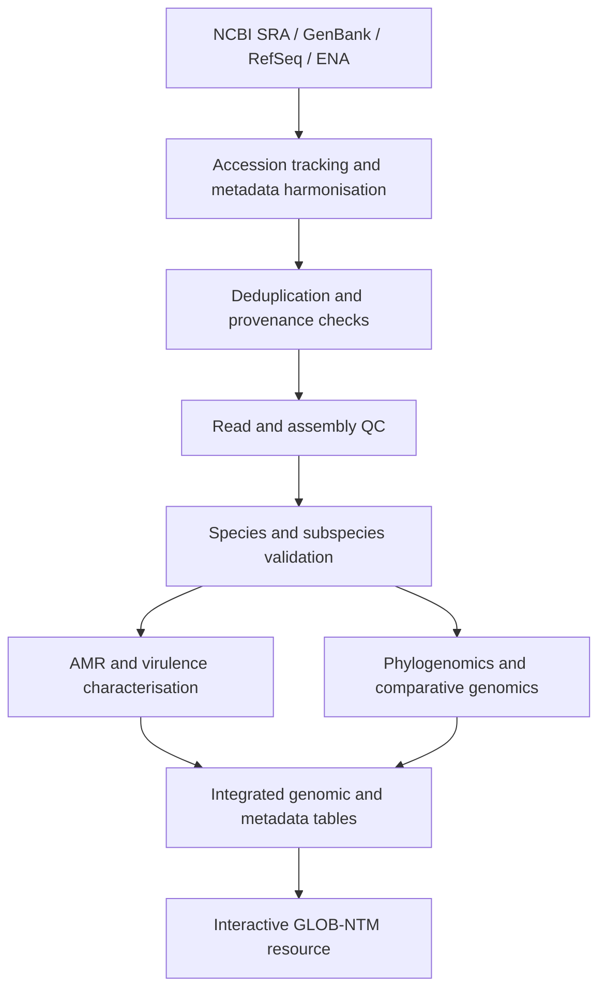

# GLOB-NTM

## A Global Genomic Resource for Nontuberculous Mycobacteria

**Status:** Research in development 
· **Approach:** Global, retrospective, in silico genomic epidemiology 
· **Data:** Publicly available genomes and associated metadata

**Research team:** Nicholas Nyabera and Emilyn Costa Conceição (Stellenbosch University, South Africa); Jody Emile Phelan (London School of Hygiene & Tropical Medicine, United Kingdom).

> GLOB-NTM aims to transform fragmented publicly available nontuberculous mycobacterial (NTM) genome datasets into a curated, standardised, reproducible and explorable global genomic resource.

## Background and rationale

NTM occur in clinical, animal and environmental settings. Species and subspecies vary in pathogenic potential, ecology and antimicrobial susceptibility. Although public repositories contain substantial NTM genomic data, uneven geographic sampling, incomplete metadata, inconsistent species assignments and limited drug-susceptibility phenotypes complicate integrated analyses. GLOB-NTM addresses these gaps through traceable data curation, genome-based taxonomy, resistance and virulence characterisation, comparative genomics and interactive exploration.

## Research question

How can publicly available NTM genomic and metadata resources be systematically curated, standardised and analysed to create a global resource for comparative NTM genomics?

## Aim

Develop GLOB-NTM as a curated, reproducible and interactive global genomic resource for nontuberculous mycobacteria.

## Specific objectives

1. **Data acquisition and curation:** Retrieve global public NTM genomes and standardise associated metadata.
2. **Genome processing and taxonomy:** Reprocess datasets, assess quality and resolve species/subspecies identities using genome-based methods.
3. **AMR and virulence:** Characterise resistance and virulence determinants, including clinically relevant sequence variants where supported by evidence.
4. **Comparative and phylogenomics:** Reconstruct phylogenetic relationships and conduct targeted comparative genomic and pangenome analyses.
5. **Resource development:** Integrate genomic results and metadata into an open, interactive and reproducible GLOB-NTM platform.

## Scope

- **Organisms:** Nontuberculous mycobacteria (NTM); *Mycobacterium tuberculosis* complex and *M. leprae* are outside the primary project scope.
- **Sources:** Human, animal and environmental isolates, wherever metadata permit.
- **Geography:** Global, with explicit assessment of geographic representation and sampling inequities.
- **Inputs:** Public sequencing reads and/or assemblies, with BioProject, BioSample and accession provenance.
- **Design:** Retrospective observational secondary analysis of public data, supplemented by literature-based metadata recovery.

## Proposed analysis workflow



| Stage | Candidate tools or approaches | Intended output |
| --- | --- | --- |
| Discovery and retrieval | NCBI Datasets, Entrez Direct, SRA Toolkit, ENA API | Accession manifest, source metadata, reads/assemblies |
| Data curation | R/Python, controlled vocabularies, accession matching | Deduplicated, harmonised metadata |
| Quality control | FastQC, fastp, assembly-quality assessment | QC metrics and pass/review/fail decisions |
| Genome identity | fastANI/skani, reference comparisons, phylogenomic placement | Validated taxonomic assignments and discordance flags |
| Resistance and virulence | AMRFinderPlus, CARD/RGI, ResFinder, VFDB, curated NTM loci | Gene and variant calls with provenance and interpretation limits |
| Comparative genomics | Core/accessory genome and pangenome approaches | Gene-content and genomic-diversity summaries |
| Phylogenomics | Snippy, Gubbins, IQ-TREE and appropriate alternatives | Reproducible alignments and phylogenies |
| Integration and visualisation | Database/API and interactive dashboard (to be selected) | Searchable, documented GLOB-NTM resource |

**Important:** These are proposed methods, not claims that the corresponding pipelines have already been implemented or validated. Tools, reference databases, thresholds and versions will be fixed and documented before production analyses.

## Repository layout

```text
GLOB-NTM/
├── README.md                  # Project overview and onboarding
├── LICENSE                    # Add only after licensing decision
├── CITATION.cff               # Project citation metadata
├── .gitignore                 # Excludes datasets, outputs and secrets
├── config/                    # Parameters and schema definitions
├── docs/                      # Protocols, decisions, methods, data dictionary
├── metadata/                  # Schemas and synthetic examples only
├── scripts/                   # Curation and utility scripts
├── workflow/
│   ├── rules/                 # Workflow modules
│   └── envs/                  # Pinned software environments
├── tests/                     # Automated tests and toy datasets
├── assets/                    # Project-approved graphics
├── results/                   # Locally generated outputs (not committed)
└── .github/workflows/         # Continuous integration (when configured)
```

## Getting started

Clone your GitHub repository after creating it:

```bash
git clone https://github.com/YOUR-USERNAME/GLOB-NTM.git
cd GLOB-NTM
```

The repository is initially a **research scaffold**. No end-to-end executable pipeline is asserted at this stage. Once workflows are implemented, this section will document installation, exact environment versions, a small test run and production execution.

## Data provenance and reproducibility

Each genomic record should retain its original accession(s), repository, BioSample and BioProject identifiers (where available), retrieval date, source metadata, processing status and taxonomic assignment history. Deduplication rules, QC thresholds, reference selection, tool versions and database releases must be versioned. Analyses should distinguish read-based from assembly-only inputs.

**Data access:** GLOB-NTM will link to authoritative sequence repositories instead of committing bulk FASTQ or genome assemblies to Git. The availability of public reads, assemblies and phenotypic susceptibility data should be tracked independently; missing data should not be silently imputed. Any personal or controlled-access metadata must be handled under applicable access restrictions.

## Interpretation safeguards

- A detected resistance gene or mutation is **not automatically** a validated clinical resistance prediction; interpretation must be species- and drug-specific and clearly distinguished from measured susceptibility.
- Genomic similarity alone does not prove transmission; epidemiological and temporal context are needed.
- Unequal sampling density limits geographic prevalence or incidence inferences.
- A species label from a repository is provisional until independently checked.
- Public data availability does not imply uniform metadata completeness or comparable sequencing quality.

## Planned outputs

- Curated global NTM genome and metadata catalogue with provenance.
- Taxonomically checked genome collection and quality reports.
- AMR and virulence characterisation linked to species and metadata.
- Phylogenomic, population-genomic and comparative-genomic analyses.
- Geographic and One Health evidence-gap assessments.
- Interactive GLOB-NTM platform and reproducible research workflows.
- Associated review, resource and comparative-genomics manuscripts.

## Roadmap

- [ ] Finalise repository governance, scope and contribution policy.
- [ ] Define metadata dictionary and accession/provenance schema.
- [ ] Implement repository queries and metadata harvesting.
- [ ] Implement deduplication and QC with test datasets.
- [ ] Implement genome-based species/subspecies checks.
- [ ] Validate AMR and virulence annotation procedures.
- [ ] Implement comparative and phylogenomic modules.
- [ ] Integrate data model, API and interactive dashboard.
- [ ] Release documented datasets, workflows and publications as appropriate.

## Contributions and contact

The project is under active research development. Before proposing code or data changes, open an issue describing the objective, inputs, expected outputs, reproducibility requirements and any licensing or data-sharing constraints. Maintainer contact and formal contribution guidance will be added following team agreement.

## Citation and licence

Please use the repository citation metadata in `CITATION.cff` until a formal GLOB-NTM publication is available. **No licence has yet been granted for code or documentation**; do not assume that repository visibility permits unrestricted reuse. Licensing and third-party database terms will be reviewed before public release.

## Acknowledgements

GLOB-NTM is developed in the context of MSc research in Bioinformatics of Infectious Diseases and Pathogen Genomics at Stellenbosch University, with collaboration involving the London School of Hygiene & Tropical Medicine. Institutional endorsement and funding acknowledgements will be included when verified.
